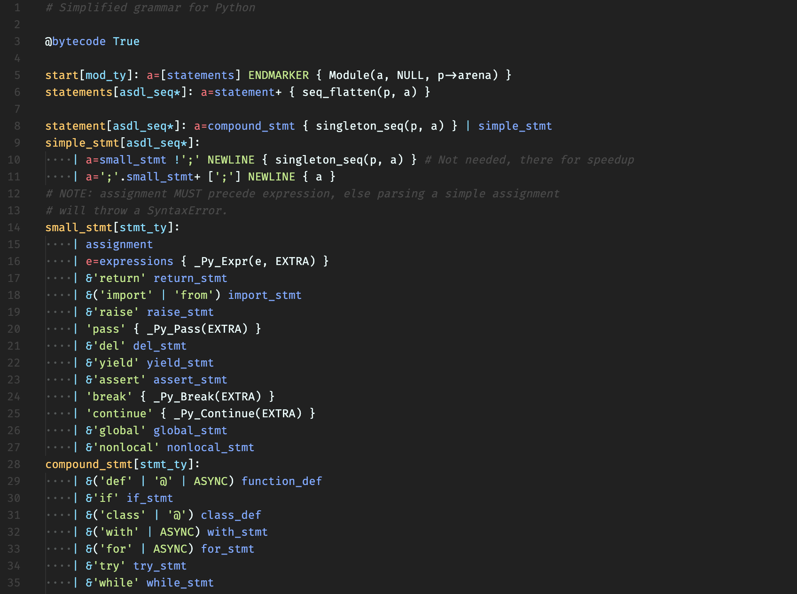

# Pegen PEG Grammar Highlighting

Syntax highlighting in VS Code for `.gram` files written in the PEG syntax used by
[pegen](https://github.com/we-like-parsers/pegen), the parser generator behind
CPython's parser. It covers the full syntax used in CPython's
[`Grammar/python.gram`](https://github.com/python/cpython/blob/main/Grammar/python.gram).



## Features

- **Rule definitions**, with return types (`rule[asdl_stmt_seq*]`, `rule[frozenset[str]]`)
  and flags (`rule[expr_ty] (memo)`)
- **Meta directives** like `@trailer`, `@subheader` and `@include`, including
  triple-quoted blocks
- **Clickable `@include` paths**: Cmd/Ctrl+Click opens the included file, resolved
  relative to the current `.gram` file
- **Keywords and soft keywords**: `'if'` and `"match"` are highlighted differently
- **Tokens** such as `NAME`, `NEWLINE` and `ENDMARKER`
- **Named items**, including typed ones (`a=expression`, `a[asdl_expr_seq*]=','.NAME+`)
- **All PEG operators**: alternatives `|`, lookaheads `&` / `!`, forced tokens `&&`,
  cut `~`, quantifiers `?` `*` `+`, gather `s.e+`, optional `[...]` and grouping `(...)`
- **Actions** (`{ ... }`), including actions that span several lines or contain
  nested braces, plus strings, comments and numbers inside them
- Comment toggling, bracket matching and auto-closing of brackets and quotes

## Installation

Install **Pegen PEG Grammar Highlighting** from the VS Code Marketplace, or run:

```sh
code --install-extension lysnikolaou.pegen-peg
```

Any file with the `.gram` extension is then highlighted.

## Development

1. Clone this repository and run `npm install`.
2. Open it in VS Code and press <kbd>F5</kbd>. This compiles the TypeScript in `src/` in
   watch mode and starts an Extension Development Host with the extension loaded.
3. Open a `.gram` file, e.g. CPython's `Grammar/python.gram`.

The grammar is in [`syntaxes/pegen.tmLanguage.json`](syntaxes/pegen.tmLanguage.json).
To see which scope a token gets, run **Developer: Inspect Editor Tokens and Scopes**
from the Command Palette. After you change the grammar, run **Developer: Reload Window**
in the development host.

## Known Issues

Code inside actions isn't highlighted as C or Python. Only strings, comments, numbers
and `NULL` / `True` / `False` / `None` get highlighted there.

## License

[MIT](LICENSE)
